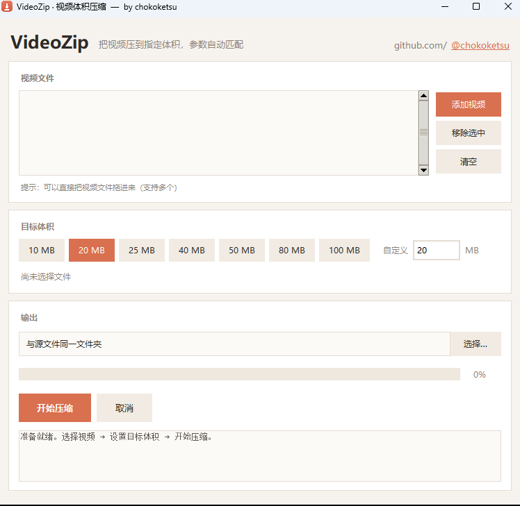

<div align="center">

# VideoZip

**把视频压到指定体积，编码参数自动反推匹配。**

说"压到 20MB"，它自己算码率、定分辨率、挑预设，双遍编码把体积锁死。

[](https://github.com/chokoketsu)
[](LICENSE)
[](https://github.com/chokoketsu)
[](https://github.com/chokoketsu)

作者 / Author：**[chokoketsu](https://github.com/chokoketsu)**

</div>



---

## 这是什么

大部分压缩工具让你自己选码率、分辨率和 CRF，选完还得试几遍才知道有没有超。

VideoZip 反过来做：**你只给它一个目标体积**（比如 20 MB），它根据时长和画面信息反推出整套编码参数，再跑两遍 x264 把体积压到这条线以内。

典型场景：邮件附件上限、微信传输、课程平台作业提交、论坛上传限制。

## 功能

- **目标体积反推**：`总码率 = 目标字节 × 8 / 时长`，预留 5% 给容器开销，音频码率按预算自动分档（48–192 kbps）
- **画质守卫**：用 bpp（每像素比特）判断画面够不够，低于阈值就自动降到标准高度（2160 / 1440 / 1080 / 720 / 576 / 480…），仍然不够才降帧
- **源画质封顶**：目标给得太宽裕时，码率不超过源码率的 1.2 倍，避免"越压越大"
- **双遍 ABR 锁体积**：`-maxrate` 取 1.5×、`-bufsize` 取 2.5×，比单遍 CRF 更能卡住体积
- **网页友好**：`+faststart` 把索引前置，边下边播
- **批量队列**：多选 / 拖放文件，逐个处理，单个失败不影响其余
- **可取消**：随时中断，不留下半成品
- **零配置 ffmpeg**：自动在 PATH、winget、常见安装目录里找；找不到可以一键下载到本机缓存

## 使用

### 方式一：下载打包版

到 [Releases](https://github.com/chokoketsu/VideoZip/releases) 页面下载最新的 `VideoZip.exe`，双击即用。二进制不进仓库，由源码构建后作为 Release 附件分发。

### 方式二：从源码运行

```bash
python -m pip install -r requirements.txt
python videozip.py
```

> 需要 Python 3.10+，Windows 自带的 python.org 安装包已包含 tkinter。
> 首次使用如果没有 ffmpeg，程序会询问是否自动下载（约 100 MB，仅一次）。

## 自己打包

```bat
build.bat
```

产物在 `dist\VideoZip.exe`，单文件、无控制台窗口。

## 参数是怎么算的

| 步骤 | 公式 / 规则 |
| --- | --- |
| 总码率 | `目标MB × 1024 × 1024 × 8 / 时长`，再 × 0.95 |
| 音频档位 | 总预算 ≥2600k→192，≥1600k→160，≥1000k→128，≥600k→96，≥350k→64，否则 48 |
| 视频码率 | 总预算 − 音频 − 3 kbps，下限 90 kbps |
| 画质指标 | `bpp = 视频kbps × 1000 / (宽 × 高 × fps)` |
| 降分辨率 | 当 bpp < 0.078，目标高度 `H·√(vb·1000 / (0.078·W·H·fps))`，向下取最近的标准档 |
| 降帧 | bpp 仍 < 0.048 且帧率 > 26 时降到 24 fps |
| 预设 | >1080p30 用 `medium`，短小低码率用 `slower`，其余 `slow` |

画质分级：bpp ≥0.12 优秀、≥0.085 好、≥0.06 中等、≥0.042 一般、其余偏低。

## 目录结构

```
VideoZip/
├─ videozip.py            # 主程序（单文件，约 950 行，无第三方 UI 框架）
├─ assets/
│  ├─ icon.ico            # 打包用图标
│  └─ icon.png            # 仓库展示用
├─ build.bat              # 本地一键打包
├─ requirements.txt
├─ NOTICE.md              # 第三方组件与许可说明
├─ .github/workflows/build.yml   # CI 自动构建 exe 产物
├─ LICENSE
└─ README.md
```

## 合规与第三方说明

本仓库刻意**只提交源码**，以下内容不入库：

- PyInstaller 打包产物（`VideoZip.exe`、`python312.dll`、`tcl86t.dll`、`tk86t.dll`、OpenSSL 等运行时二进制）——体积大且属于第三方发行物，仓库体积与许可证边界都不适合承载
- ffmpeg / ffprobe 可执行文件——程序**不重新分发** FFmpeg，而是在用户本机首次运行时由用户自行下载（来源 gyan.dev 构建），许可责任清晰

依赖与许可：

| 组件 | 用途 | 许可 |
| --- | --- | --- |
| [tkinterdnd2](https://pypi.org/project/tkinterdnd2/) | 拖放支持（可选，缺失时自动降级为点选） | MIT |
| Tcl/Tk (via Python) | GUI 运行时 | BSD-style |
| FFmpeg / x264 | 编码后端（运行时不打包） | LGPL / GPL，详见 [NOTICE.md](NOTICE.md) |
| 本项目代码 | — | MIT |

## 作者

**chokoketsu**

- GitHub：<https://github.com/chokoketsu>

如果这个工具帮你省了几次手动试码率的时间，给个 Star 就好。

## 许可

[MIT](LICENSE) © 2026 chokoketsu
